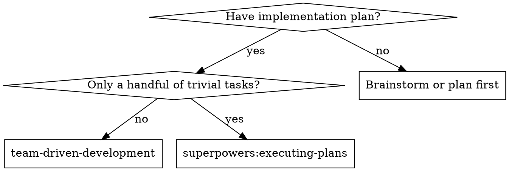
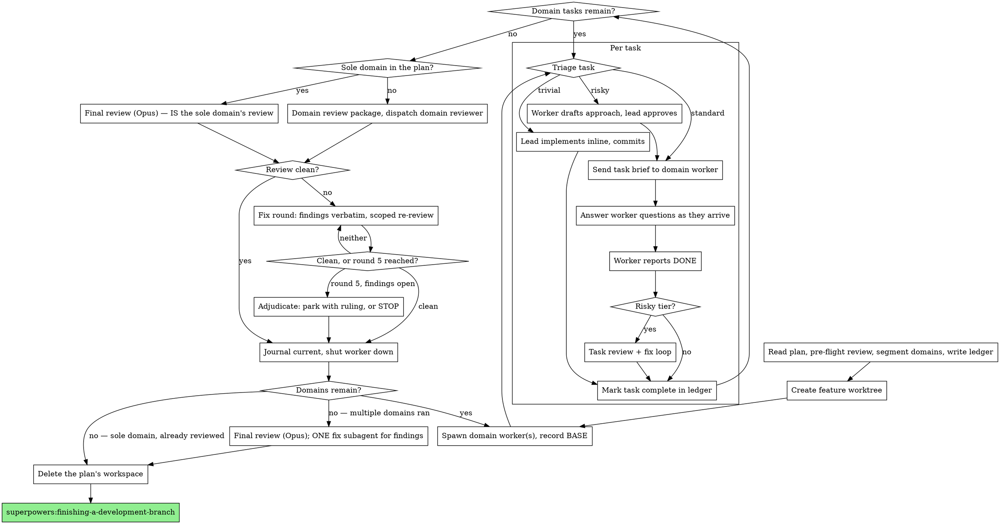

# Team-Driven Development

Execute a plan by leading persistent worker teammates: one worker per context domain, task triage before every dispatch, live question-answering while workers work, a fresh review of each worker's whole diff before it shuts down, and a whole-branch review at the end.

You hold the plan, the spec, and access to your human partner; each worker holds its domain. Questions flow up, decisions flow down. Workers stay for their whole domain — they onboard to their code area once and carry that knowledge across tasks.

**Narration:** between tool calls, narrate at most one short line — the ledger and the tool results carry the record.

**Continuous execution:** do not pause to check in with your human partner between tasks or between domains. The reasons to stop: a BLOCKED status you cannot resolve, a decision that is genuinely your human partner's to make (see Answering Worker Questions), results that need their review — validation results, benchmark numbers, experiment outcomes — or all tasks complete.

## When to Use

If this session cannot message other agents (no SendMessage tool), fall back to superpowers:subagent-driven-development — plans are format-identical, nothing is lost.

## Team Structure

| Role | Runs as | Model | Lifetime |
|---|---|---|---|
| Lead (you) | Main session | Session model | Whole plan |
| Worker | Persistent teammate | Sonnet default; Haiku only when the domain's tasks are pure transcription of plan-provided code | One context domain |
| Reviewer | One-shot subagent | Sonnet or Haiku ONLY, by diff size and risk — never the session model | Per review (risky task or domain) |
| Re-reviewer | One-shot subagent | Sonnet or Haiku, scaled to the fix diff | Per fix round |
| Fix subagent | One-shot subagent | Sonnet | Fix rounds 4–5; the final review's fix wave |
| Final whole-branch reviewer | One-shot subagent | Opus, always | Once |

Workers are teammates because they benefit from persistence: codebase knowledge accumulates across tasks, and review fixes go to someone who remembers writing the code. Reviewers are subagents because they benefit from fresh eyes: no accumulated bias from watching the code get written. Do not invert this.

**You coordinate; you do not implement.** Your context holds the plan, the ledger, and every worker's thread, and cannot be replaced when it fills. Code you write also dodges review, since reviews run on worker diffs. Limit your own edits to the ledger and trivial-tier tasks; if your harness offers a delegate mode that disables the lead's edit tools, turn it on.

## How Team Communication Actually Works

**A teammate reads its inbox only at a turn boundary** — when it stops and yields, not between its own tool calls. Your message to a working teammate sits unread until it finishes. This is designed behavior, not a bug or a misconfiguration; no setting changes it. The rest of this section is consequences.

- **Pull, don't push.** Anything a worker must know *before* it acts belongs in the brief or the task message it reads first. You cannot steer a running worker — your correction lands after the turn it was meant to prevent. When one is heading somewhere wrong, let the turn land and correct against the diff.
- **Status belongs on the task list.** `TaskCreate` at dispatch, workers `TaskUpdate`, you `TaskList`: current state for free, without costing anyone a turn. Messages are for decisions — questions, answers, findings, dispatches.
- **Batch what you send.** Two messages in one turn arrive together anyway, and every round trip costs a turn boundary. A complete answer beats a fast one that triggers a follow-up.
- **Never reply to a stale message.** A teammate answering something you already resolved wrote it before seeing your newer dispatch, and is already working on the newer one. Replying starts an unbounded exchange of stale traffic — resolve it in the ledger instead, even when the stale message asks a direct question.
- **An idle notice is not a status report.** It fires at every turn end, including right after a worker launches a background command, and it can race with the worker's own message.

**On an idle notice, check ground truth — never send a check-in.** `TaskList`, then `git log --oneline BASE..HEAD`, then whether the task's report file exists. All free; a check-in costs the worker a turn and buys crossed messages. Message only after two idle notices with no progress, and then ask one specific question, not "status?". Never poll with a foreground `sleep`: waiting costs you nothing — there is a ledger to update and a next brief to extract — and a sleep loop converts that into billed wall-clock.

## Context Domains

At plan read, segment the plan's tasks into **context domains** — groups that share files, interfaces, or knowledge. A domain is the unit of worker context: one worker per domain, spawned at domain start, shut down at domain end after its review is clean and its journal is current.

Most plans do not mark this structure — a flat plan with 20 tasks is normal. Derive it yourself from task ordering and per-task file lists: which tasks touch the same code, which consume interfaces earlier tasks produce. YOU decide the batching and the worker assignments; the plan won't.

Domains relate to each other in two ways, and both are normal:

- **Dependent** (one consumes what the other produces, or they touch the same files): run them in sequence. The successor worker inherits through the journal — the interface knowledge that matters and nothing else.
- **Disjoint** (no file overlap, no output→input dependency): they may run in parallel, each worker with its own territory. See Parallel Domains.

If you cannot tell whether two domains are disjoint, ask your human partner once at kickoff, folded into the pre-flight question batch. Do not interrupt mid-execution for segmentation doubts you could have raised at the start.

**Worker lifetime is the domain, and long is the point.** Never rotate on a token or compaction count: persistence is the whole reason workers are teammates rather than one-shot subagents, and a 200K window auto-compacting several times across a long domain is normal operation. Rotate only on behavior — repeated errors it did not make earlier, contradicting its own journal, looping.

### When a Worker Dies Mid-Task

A session limit or crash leaves uncommitted work and no report. Recover; do not inherit.

1. **Reset the working tree to the task's BASE.** Do not read the draft into your context, and do not finish it yourself: reconstructing intent from a partial diff costs more than redoing the task, and leaves nothing for the review to check against.
2. **Spawn a replacement** for the same domain from the same prompt, adding three pointers — the dead worker's journal, the domain's completed report files, `git log --oneline BASE..HEAD`. Onboarding is one read; that is what the journal is for.
3. **Re-dispatch the unfinished task** from its brief, unchanged.
4. **Ledger:** `Task N: worker died mid-task, draft abandoned, redispatched to <new worker>`.

If you cannot tell whether a quiet worker is dead, send one light liveness probe and check ground truth; no reply by the next idle notice means dead. One probe, not a series. The domain still gets its review against the same BASE, and the replacement fixes the findings.

**Name workers by their domain** (`data-pipeline`, `react-frontend`), never by number. The spawn prompt's identity block gives each worker its territory and its expertise: when the domain partition is technology-shaped, name the role explicitly and instruct the worker to act as that specialist ("you are the React specialist; act as a senior React engineer"); otherwise describe the subsystem expertise ("you are the specialist for the training loop").

## The Process

## Pre-Flight Plan Review

Before spawning anything, scan the plan once for conflicts — tasks that contradict each other or the plan's Global Constraints, and anything the plan explicitly mandates that the review rubric treats as a defect. Add segmentation doubts (which domains are disjoint?) to the same batch. Present everything as ONE batched question to your human partner before execution begins. If the scan is clean, proceed without comment.

## Task Triage

Triage every task into one of three tiers before acting. This decision is yours, per task — the plan does not make it for you.

| Tier | Signals | Handling |
|---|---|---|
| **Trivial** | Config tweak, rename, one-liner where the plan contains the exact change | You implement it inline and commit. No dispatch — the domain and final reviews cover it. |
| **Standard** | Everything else — the default | Task brief to the domain worker. |
| **Risky** | New architecture, shared interfaces, anything you are uncertain about | Worker messages back a short approach plan BEFORE writing code; you approve or correct (escalate if the plan itself is in question); then the standard flow, plus a task review (always Sonnet) on DONE — the only tier reviewed per task. |

Triage honestly. A task is trivial only when the plan's text already contains the complete change and getting it wrong would be caught by `git diff` at a glance. When in doubt, it is standard.

## Dispatching Tasks

- Extract the task brief to a file: `scripts/task-brief PLAN_FILE N` (from this skill's directory — prints the path it wrote). The brief is the single source of requirements; exact values appear only there.
- `TaskCreate` the task, assigned to the worker, before you send it — that entry is your status channel for its lifetime.
- Send the worker a thin task message: the brief path ("read this first — it is your requirements, with the exact values to use verbatim"), where the task fits, interfaces or decisions from earlier tasks the brief cannot know, your resolution of any ambiguity you already noticed, and the report file path (brief `…/task-N-brief.md` → report `…/task-N-report.md`).
- **Name the plausible-but-wrong approach when you can see one**, with why it looks right: *"gate on `isEnrolled()`, not `willRender()` — `willRender()` is true during the shadow pass, so gating on it silently double-counts."* A worker given a bare rule applies it literally; one given the reasoning generalizes it to cases you did not anticipate. Don't manufacture a trap when none is apparent.
- One task per worker at a time, and never a next task while the current one has an open review.

## Answering Worker Questions

Workers are instructed to message you the moment they hit ambiguity, an unexpected obstacle, or a decision with consequences beyond their territory. Handling their questions well is the correctness core of this skill:

- **Answer from the plan, the spec, or the codebase** whenever the answer is derivable. Ordinary engineering judgment within the plan's intent is yours to exercise.
- **Escalate to your human partner** when: the plan or spec is wrong, contradictory, or contradicted by a review finding; the decision changes scope, external interfaces, or dependencies beyond what the spec pins down; resolution requires non-trivial re-planning; or a task produced results your human partner needs to see — validation results, benchmark numbers, experiment outcomes that inform judgment. Plan conflicts are ALWAYS your human partner's call.
- **Never answer by guessing when the plan is silent** on something that matters. "The spec doesn't say" plus "it has consequences beyond the task" equals escalation, not improvisation.
- Answer promptly — a worker waiting on you is idle capacity — but completely. A terse answer that triggers two follow-up questions is slower than a full answer.

## Handling Worker Status

Workers report `DONE`, `DONE_WITH_CONCERNS`, or `BLOCKED`. Missing information is never an exit status — workers ask mid-task.

**Verify a status against ground truth before acting on it:** the SHAs it names must resolve, the report file must exist, and the test command it claims must appear in the report with its output. Three cheap checks that catch optimistic reports before a reviewer sees them. Claims that don't check out go back to the worker with the specific mismatch.

**DONE:** for a risky task, run its task review first (see Reviews). Then mark the task complete in the ledger and send the next task. After the domain's last task, tell the worker the domain is closing — its cue to run the full suite, lint, and typecheck once — then start the domain review.

**DONE_WITH_CONCERNS:** read the concerns before proceeding. Correctness or scope concerns get addressed before review; observations get noted in the ledger and carried to review.

**BLOCKED:** means "communication did not resolve this — the fix is structural": the task needs splitting, the plan is wrong, or the environment is broken. Assess which, and either restructure (split the task, fix the environment) or escalate to your human partner (plan is wrong).

**BLOCKED without having asked anything is a protocol violation.** Push back once: point the worker at its communication contract and have it ask the actual question. If the block is real, handle it as above.

## Reviews

- The default review unit is the domain: one review of the worker's whole diff after its last task, while the worker is still live to fix findings. Standard and trivial tasks get no per-task review — they ship on the worker's tests and self-review until the domain review.
- Risky tasks are the exception: review each one on its own diff as soon as the worker reports DONE, always on Sonnet.
- Record the commit at domain start as the domain's BASE in the ledger, and the commit before each risky task as that task's BASE — review packages come from `scripts/review-package PLAN_FILE BASE HEAD` (prints the path it wrote). Never diff from `HEAD~1`; it silently drops everything before the last commit.
- The reviewer gets the brief files, the report files, and the review package path, plus the plan's binding Global Constraints copied verbatim. The template carries the process rules; the constraints block is for what THIS project's spec demands.
- Do not pre-judge findings: never tell a reviewer what not to flag or pre-rate a finding's severity. Adjudicate at the cap, not before. A review returning only one of its two verdicts (spec compliance AND work quality) is incomplete — re-dispatch it.
- Record Minor findings in the ledger as you go; point the final whole-branch review at that list to triage what must be fixed before merge.
- A finding that conflicts with what the plan's text mandates is your human partner's decision — present the finding and the plan text, ask which governs.

### The Fix Loop

Critical/Important findings and spec gaps start a bounded fix loop, at most **five rounds**. Minor findings go to the ledger, never into the loop. Each round:

1. **Forward the findings VERBATIM** — never paraphrase, summarize, or soften.
2. The fixer fixes, re-runs the tests covering the amended code, appends results to the report file.
3. Dispatch a **fresh scoped re-review** ([re-review-prompt.md](re-review-prompt.md)) on `scripts/review-package PLAN_FILE FIX_BASE HEAD`, FIX_BASE being the head the previous review saw. It verdicts each finding ADDRESSED / NOT ADDRESSED and checks the fix diff for new breakage; it does not re-review the whole diff. Out-of-scope observations go to the ledger, not into this loop.
4. Ledger: `Task N: fix round R/5 (X addressed, Y open — <finding one-liners>; commits <a7>..<b7>)`.

**Rounds 1–3** go to the domain worker that wrote the code — it has the context and is still live. **Rounds 4–5** go to a fresh one-shot fix subagent, given the brief, the report file, the open findings verbatim, and the framing *"a prior implementer attempted this task N times; you own it now — read the report file for what was tried."* Put it a tier above the worker where there is room (Haiku worker → Sonnet fixer; Sonnet is the ceiling), and leave the domain worker in place — it keeps the domain, it just does not own this fix. Three failed attempts means the context that wrote the defect is the context that cannot see it.

**At the round-5 cap**, stop fixing and adjudicate each still-open finding: reviewer wrong or the point genuinely contestable → park it (`Task N: parked — <finding> — ruling: <why the code stands>`); real but nothing downstream depends on it → park the same way, and the final review sees it again; real and load-bearing → STOP, ledger `Task N: BLOCKED — <reason>`, report to your human partner with what was tried. Adjudicate only at the cap — adjudicating earlier to end a loop is pre-judging with a different name.

A worker shuts down only once its review is clean or its open findings are parked with rulings. Completion line: `Task N: complete (commits <base7>..<head7>, review clean)`, or `… review clean, K parked)`.

### Final Whole-Branch Review

Always Opus, on `scripts/review-package PLAN_FILE MERGE_BASE HEAD` (MERGE_BASE = `git merge-base main HEAD`), using superpowers:requesting-code-review's code-reviewer template, with the ledger's Minor findings and parked rulings attached for triage.

Point it at end-to-end execution paths, not just the diff. Domain reviews are diff-shaped and structurally blind to bugs living in the *relationship* between two individually correct modules — ordering, lifecycle, who-calls-whom. Instruct it to trace the system's core invariants through the real call path, reading upstream source outside the diff where needed. That class of bug is why this review is not optional.

With a single domain, this IS that domain's review: run it before the worker shuts down and route findings through the fix loop. With multiple domains, run it after all workers have shut down and send findings to **ONE** fix subagent as a complete list — a real session's final-review fix wave cost more than all its tasks combined. Then one scoped re-review of that wave and no second wave; anything still open is adjudicated as at the round-5 cap.

## Parallel Domains

Disjoint domains — no file overlap, no output→input dependency — may run in parallel, one worker each. **Serialize when unsure**; merge conflicts cost more than the time saved.

When running parallel workers:

- **Strict file ownership:** every file has exactly one owner; shared types are created by one domain and read-only for the others. If ownership cannot be partitioned cleanly, the domains were not disjoint — serialize them.
- **Worktree isolation:** each parallel worker gets its own git worktree on its own branch off the feature branch. You merge each domain branch back into the feature branch at domain completion. (Sequential execution stays in the single feature worktree; no merging.)
- A file conflict despite the ownership map is a segmentation error: stop the workers involved, resolve ownership, reassign, and record it in the ledger.
- Every active worker adds question traffic to you, and your careful answers are the correctness mechanism. Run only as many parallel workers as you can answer attentively.

## Durable Progress: Ledger and Journal

Two artifacts, deliberately kept apart, both in the workspace `scripts/team-workspace PLAN_FILE` creates and prints (`<repo-root>/.superpowers/team-dev/<plan-basename>/`, git-ignored). It is keyed to the plan, so a resumed session on the same plan finds this ledger and a different plan cannot overwrite it.

- **Ledger** (`progress.md`) — YOUR memory, the only bookkeeping in your context. First line: `# Team-dev ledger — plan: <plan file path>`. A ledger naming a different plan is another plan's progress — leave it alone and start your own, fresh. Then the **roster** (per worker: name, model, domain, BASE, live/shut down), the domain map, one line per completed task, fix-round and parked lines, Minor findings, segmentation errors. At skill start, resume at the first task not marked complete. After compaction or resume, trust the ledger and `git log` over your own recollection.
- **Journal** (`journal-<domain>.md`) — the WORKERS' inheritance: each keeps its own current as it finishes each task (files touched, interfaces created, conventions, gotchas). You handle only the path, never the content — a successor's spawn prompt lists the journals of the domains it depends on. Never read journal content into your context or summarize it for a worker.

Everything you paste into a message stays resident in your context for the rest of the session. Hand artifacts over as files; messages carry paths and short statuses.

**Delete the plan's workspace** (`rm -rf <workspace>`) once the final review is clean and its fixes are merged — it was scaffolding, and the branch history carries whatever outlives it. Only this plan's directory: siblings belong to other plans.

## Team Lifecycle

1. **Spawn** from ./worker-prompt.md — always name the model explicitly; teammates do not inherit yours. Add each to the ledger roster.
2. **Close the domain:** tell the worker it is closing (its cue for the one full suite / lint / typecheck run), then run the domain review and its fix loop.
3. **Shut down:** confirm the journal is current on disk FIRST, then request shutdown and wait for confirmation; mark it in the roster.
4. **Final whole-branch review** only once every worker has confirmed shutdown — then delete the workspace and hand off to superpowers:finishing-a-development-branch.

Workers do not survive a session resume. On resume, spawn fresh workers — do not message the old names.

## Red Flags

Thoughts you will actually have mid-run, and why each is wrong.

| Rationalization | Reality |
|---|---|
| "This one's small, I'll just do it myself" | Triage said worker. Your edits pollute the one context holding the whole plan, and dodge review. |
| "The session model already has the context, use it for the review" | That accumulated context is exactly the bias review exists to escape. Sonnet or Haiku; the final review, Opus. |
| "This standard task looked tricky — one quick review won't hurt" | Only risky tasks and domains get reviewed. Reviewing every task is much of what made this workflow expensive. |
| "I'll tighten these findings so the worker sees the point" | Forward verbatim. Every paraphrase drops the detail that made the finding checkable. |
| "The plan is silent, but the sensible reading is obvious" | An obvious reading is a guess with confidence attached. Silent plan plus consequences beyond the task equals escalation. |
| "It reported BLOCKED, so it's genuinely stuck" | BLOCKED without having asked anything is a protocol violation. Push back once and make it ask. |
| "Round 3 and still failing — the reviewer is probably wrong" | Adjudicate at the cap, not before. Rounds 4–5 go to a fresh fixer; adjudicating early is pre-judging under a different name. |
| "It's been quiet a while, I'll check in" | An idle notice is not a status report. `TaskList`, `git log`, report file — all free. A check-in costs the worker a turn, as does a sleep loop waiting for it. |
| "It just asked something I already answered — I should correct it" | That message crossed yours; it already has the newer instruction. Replying starts an unbounded exchange of stale traffic. |
| "I'll message it mid-task to redirect it" | Messages land at turn boundaries. Your redirect arrives after the turn it was meant to prevent — correct against the diff instead. |
| "The suite is fast; running it every task is safer" | Full suite, lint, and typecheck once per domain. Per-task suites re-run hundreds of tests no scoped change could touch. |
| "The worker died mid-task — I'll just finish its draft" | Reset to BASE and re-dispatch to a replacement. A finished draft has no report and nothing to review against. |
| "It has compacted a few times, I should rotate it" | Compaction is normal operation. Rotate on behavior, never on a token count. |
| "Everything's reviewed per domain; the whole-branch review is ceremony" | It is the only review that sees cross-module bugs. Never skip it. |

## Prompt Templates

- [worker-prompt.md](worker-prompt.md) — spawn a domain worker teammate
- [reviewer-prompt.md](reviewer-prompt.md) — dispatch a reviewer subagent (risky task or whole domain)
- [re-review-prompt.md](re-review-prompt.md) — verify one fix round: per-finding verdicts plus the fix diff
- Final whole-branch review: superpowers:requesting-code-review's code-reviewer template, on Opus

## Integration

**Required workflow skills:**
- **superpowers:writing-plans** — creates the plan this skill executes (standard format; no team-specific plan changes)
- **superpowers:using-git-worktrees** — feature worktree at kickoff; per-worker worktrees for parallel domains
- **superpowers:requesting-code-review** — template for the final whole-branch review
- **superpowers:finishing-a-development-branch** — after the final review

**Workers use:**
- **superpowers:test-driven-development** — workers follow TDD per task

**Alternatives:**
- **superpowers:executing-plans** — when the plan is only a handful of trivial tasks
- **superpowers:subagent-driven-development** — same plans, one-shot subagents; use when the session cannot message other agents
