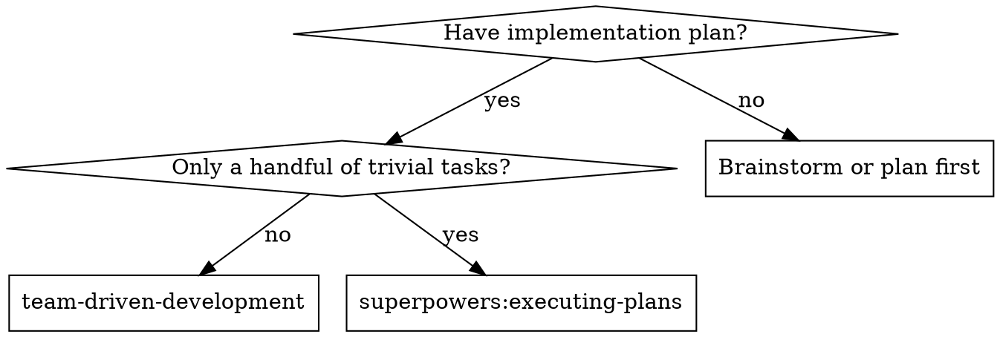

# Team-Driven Development

Execute a plan by leading persistent worker teammates: one worker per context domain, task triage before every dispatch, live question-answering while workers work, a fresh review of each worker's whole diff before it shuts down, and a whole-branch review at the end.

You hold the plan, the spec, and access to your human partner; each worker holds its domain. Questions flow up, decisions flow down. Workers stay for their whole domain — they onboard to their code area once and carry that knowledge across tasks.

**Narration:** between tool calls, narrate at most one short line — the ledger and the tool results carry the record.

**Continuous execution:** do not pause to check in with your human partner between tasks or between domains. The reasons to stop: a BLOCKED status you cannot resolve, a decision that is genuinely your human partner's to make (see Answering Worker Questions), results that need their review — validation results, benchmark numbers, experiment outcomes — or all tasks complete.

## When to Use



If this session cannot message other agents (no SendMessage tool), fall back to superpowers:subagent-driven-development — plans are format-identical, nothing is lost.

## Team Structure

| Role | Runs as | Model | Lifetime |
|---|---|---|---|
| Lead (you) | Main session | Session model | Whole plan |
| Worker | Persistent teammate | Sonnet default; Haiku only when the domain's tasks are pure transcription of plan-provided code | One context domain |
| Reviewer | One-shot subagent | Sonnet or Haiku ONLY, by diff size and risk — never the session model | Per review (risky task or domain) |
| Re-reviewer | One-shot subagent | Sonnet or Haiku, scaled to the fix diff | Per fix round |
| Fix subagent | One-shot subagent | Sonnet | Fix rounds 4–5; the final review's fix wave |
| Final whole-branch reviewer | One-shot subagent | Opus, always | Once |

Workers are teammates because they benefit from persistence: codebase knowledge accumulates across tasks, and review fixes go to someone who remembers writing the code. Reviewers are subagents because they benefit from fresh eyes: no accumulated bias from watching the code get written. Do not invert this.

**You coordinate; you do not implement.** Your context is the scarcest resource on the team — it holds the plan, the ledger, and every worker's thread, and it cannot be replaced when it fills. Code you write yourself also dodges review, because reviews are dispatched against worker diffs. Your own edits are limited to the ledger and to trivial-tier tasks (see Task Triage). If your harness offers a delegate mode that disables the lead's edit tools, turn it on — the constraint is easier to keep as a setting than as a resolution.

## How Team Communication Actually Works

**A teammate reads its inbox only at a turn boundary** — when it stops and yields, not between its own tool calls. A message you send to a working teammate sits unread until that teammate finishes what it is doing. This is designed behavior, not a bug and not a misconfiguration; no setting changes it. Most of this skill's coordination rules are consequences of it, so learn it once here rather than rediscovering it as lag.

- **Pull, don't push, for anything time-critical.** Anything a worker must know *before* it acts has to be in the brief or the task message it reads first. Once a worker is running, you cannot steer it mid-turn: your correction arrives after the turn it was meant to prevent. When you realize a running worker is heading somewhere wrong, the cheapest move is almost always to let the turn land and correct against the actual diff — not to fire off a message and assume it took effect.
- **Status belongs on the task list, not in messages.** Create the domain's tasks with `TaskCreate` at dispatch; workers mark them in_progress and completed with `TaskUpdate`. `TaskList` gives you the current state for free, at any moment, without costing a worker a turn. Reserve messages for content that needs a decision: questions, answers, findings, dispatches.
- **Batch what you send.** Two messages to the same worker in one turn arrive together anyway. A complete answer beats a fast one that triggers a follow-up — each round trip costs a full turn boundary.
- **Never reply to a stale message.** When a teammate's message answers something you have already resolved, it was written before the teammate saw your newer dispatch. By the time it reaches you the worker is already on the newer instruction. Correcting the record only confuses it and starts an unbounded exchange of stale traffic. Resolve it in the ledger and let your newer message stand — even when the stale one asks a direct question or reports a disagreement.
- **An idle notification is not a status report.** It fires whenever a teammate's turn ends, including immediately after it launches a long background command, and it can race with the teammate's own real message. It is not evidence anything is wrong.

**On an idle notice, check ground truth — do not send a check-in message.** Ground truth is free and does not cost the worker a turn; a check-in does, and it produces crossed messages that tell you nothing the check already told you. In order:

1. `TaskList` — what does the worker say its task's status is?
2. `git log --oneline BASE..HEAD` — are there new commits?
3. Does the report file for the current task exist yet?
4. If a status message did arrive, verify its claims: the SHAs it names must resolve, the report file must be on disk, the test command must appear in the report with its output.

Only if all of that shows no progress across two idle notices should you message the worker — and then ask one specific question, not "status?".

**Never poll with a foreground `sleep`.** Waiting on a worker costs you nothing: you have other domains to plan, a ledger to update, and the next brief to extract. A sleep loop converts free waiting into billed wall-clock and tells you nothing a single ground-truth check would not.

## Context Domains

At plan read, segment the plan's tasks into **context domains** — groups that share files, interfaces, or knowledge. A domain is the unit of worker context: one worker per domain, spawned at domain start, shut down at domain end after its review is clean and its journal is current.

Most plans do not mark this structure — a flat plan with 20 tasks is normal. Derive it yourself from task ordering and per-task file lists: which tasks touch the same code, which consume interfaces earlier tasks produce. YOU decide the batching and the worker assignments; the plan won't.

Domains relate to each other in two ways, and both are normal:

- **Dependent** (one consumes what the other produces, or they touch the same files): run them in sequence. The successor worker inherits through the journal — the interface knowledge that matters and nothing else.
- **Disjoint** (no file overlap, no output→input dependency): they may run in parallel, each worker with its own territory. See Parallel Domains.

If you cannot tell whether two domains are disjoint, ask your human partner once at kickoff, folded into the pre-flight question batch. Do not interrupt mid-execution for segmentation doubts you could have raised at the start.

**Worker lifetime is the domain, and long is the point.** Do not rotate a worker on a token count or a compaction count. Persistence is the whole reason workers are teammates rather than one-shot subagents: what a worker has learned about its domain is worth more than the context it costs, and a Haiku worker's context is cheap. A 200K window will auto-compact several times across a long domain — that is normal operation, not a warning sign. Rotate only on a real behavioral signal: the worker repeats mistakes it did not make earlier, contradicts decisions recorded in its own journal, or loops.

### When a Worker Dies Mid-Task

Session limits and crashes take workers out mid-task, leaving uncommitted work and no report. Recover; do not inherit.

1. **Abandon the uncommitted draft** — reset the working tree to the task's BASE. Do not read the draft into your context, and do not finish it yourself. Reconstructing intent from a partial diff costs more than redoing the task from its brief, and the result has no report for the review to check against.
2. **Spawn a fresh worker for the same domain**, from the same spawn prompt, adding three onboarding pointers: the dead worker's journal, the report files of the domain's completed tasks, and `git log --oneline BASE..HEAD`. The journal exists precisely for this — onboarding costs one read, not a re-derivation.
3. **Re-dispatch the unfinished task** from its brief, unchanged.
4. **Ledger:** `Task N: worker died mid-task, draft abandoned, redispatched to <new worker>`.

If a worker has gone quiet and you cannot tell whether it is dead, send one very light liveness probe — ask it to confirm it is alive in a single line — and check ground truth. No reply by the following idle notice means dead; recover as above. One probe, not a series.

A domain whose worker died still gets its domain review, run against the same BASE. The replacement worker fixes the findings.

**Name workers by their domain** (`data-pipeline`, `react-frontend`), never by number. The spawn prompt's identity block gives each worker its territory and its expertise: when the domain partition is technology-shaped, name the role explicitly and instruct the worker to act as that specialist ("you are the React specialist; act as a senior React engineer"); otherwise describe the subsystem expertise ("you are the specialist for the training loop").

## The Process

```dot
digraph process {
    rankdir=TB;

    "Read plan, pre-flight review, segment into domains, resolve workspace, write ledger" [shape=box];
    "Create feature worktree (superpowers:using-git-worktrees)" [shape=box];
    "Spawn worker(s) for current domain(s), record domain BASE (./worker-prompt.md)" [shape=box];

    subgraph cluster_per_task {
        label="Per task";
        "Triage task" [shape=diamond];
        "Lead implements inline, commits" [shape=box];
        "Worker drafts approach, lead approves" [shape=box];
        "Send task brief to domain worker" [shape=box];
        "Answer worker questions as they arrive" [shape=box];
        "Worker reports DONE" [shape=box];
        "Risky tier?" [shape=diamond];
        "Dispatch task reviewer (./reviewer-prompt.md); run the fix loop" [shape=box];
        "Mark task complete in ledger" [shape=box];
    }

    "Domain tasks remain?" [shape=diamond];
    "Sole domain in the plan?" [shape=diamond];
    "Generate domain review package, dispatch domain reviewer (./reviewer-prompt.md)" [shape=box];
    "Dispatch final whole-branch reviewer (Opus) — this IS the sole domain's review" [shape=box];
    "Review clean?" [shape=diamond];
    "Fix round: findings verbatim to worker, scoped re-review (./re-review-prompt.md)" [shape=box];
    "Clean, or round 5 reached?" [shape=diamond];
    "Adjudicate each open finding: park with ruling, or STOP" [shape=box];
    "Worker confirms journal current, confirm shutdown" [shape=box];
    "Domains remain?" [shape=diamond];
    "Dispatch final whole-branch reviewer (Opus); ONE fix subagent for any findings" [shape=box];
    "Delete this plan's workspace" [shape=box];
    "superpowers:finishing-a-development-branch" [shape=box style=filled fillcolor=lightgreen];

    "Read plan, pre-flight review, segment into domains, resolve workspace, write ledger" -> "Create feature worktree (superpowers:using-git-worktrees)";
    "Create feature worktree (superpowers:using-git-worktrees)" -> "Spawn worker(s) for current domain(s), record domain BASE (./worker-prompt.md)";
    "Spawn worker(s) for current domain(s), record domain BASE (./worker-prompt.md)" -> "Triage task";
    "Triage task" -> "Lead implements inline, commits" [label="trivial"];
    "Triage task" -> "Worker drafts approach, lead approves" [label="risky"];
    "Triage task" -> "Send task brief to domain worker" [label="standard"];
    "Worker drafts approach, lead approves" -> "Send task brief to domain worker";
    "Send task brief to domain worker" -> "Answer worker questions as they arrive";
    "Answer worker questions as they arrive" -> "Worker reports DONE";
    "Worker reports DONE" -> "Risky tier?";
    "Risky tier?" -> "Dispatch task reviewer (./reviewer-prompt.md); run the fix loop" [label="yes"];
    "Risky tier?" -> "Mark task complete in ledger" [label="no"];
    "Dispatch task reviewer (./reviewer-prompt.md); run the fix loop" -> "Mark task complete in ledger";
    "Lead implements inline, commits" -> "Mark task complete in ledger";
    "Mark task complete in ledger" -> "Domain tasks remain?";
    "Domain tasks remain?" -> "Triage task" [label="yes"];
    "Domain tasks remain?" -> "Sole domain in the plan?" [label="no"];
    "Sole domain in the plan?" -> "Dispatch final whole-branch reviewer (Opus) — this IS the sole domain's review" [label="yes"];
    "Sole domain in the plan?" -> "Generate domain review package, dispatch domain reviewer (./reviewer-prompt.md)" [label="no"];
    "Dispatch final whole-branch reviewer (Opus) — this IS the sole domain's review" -> "Review clean?";
    "Generate domain review package, dispatch domain reviewer (./reviewer-prompt.md)" -> "Review clean?";
    "Review clean?" -> "Fix round: findings verbatim to worker, scoped re-review (./re-review-prompt.md)" [label="no"];
    "Fix round: findings verbatim to worker, scoped re-review (./re-review-prompt.md)" -> "Clean, or round 5 reached?";
    "Clean, or round 5 reached?" -> "Fix round: findings verbatim to worker, scoped re-review (./re-review-prompt.md)" [label="neither"];
    "Clean, or round 5 reached?" -> "Adjudicate each open finding: park with ruling, or STOP" [label="round 5, findings open"];
    "Clean, or round 5 reached?" -> "Worker confirms journal current, confirm shutdown" [label="clean"];
    "Adjudicate each open finding: park with ruling, or STOP" -> "Worker confirms journal current, confirm shutdown";
    "Review clean?" -> "Worker confirms journal current, confirm shutdown" [label="yes"];
    "Worker confirms journal current, confirm shutdown" -> "Domains remain?";
    "Domains remain?" -> "Spawn worker(s) for current domain(s), record domain BASE (./worker-prompt.md)" [label="yes"];
    "Domains remain?" -> "Dispatch final whole-branch reviewer (Opus); ONE fix subagent for any findings" [label="no — multiple domains ran"];
    "Domains remain?" -> "Delete this plan's workspace" [label="no — sole domain, already reviewed"];
    "Dispatch final whole-branch reviewer (Opus); ONE fix subagent for any findings" -> "Delete this plan's workspace";
    "Delete this plan's workspace" -> "superpowers:finishing-a-development-branch";
}
```



## Pre-Flight Plan Review

Before spawning anything, scan the plan once for conflicts — tasks that contradict each other or the plan's Global Constraints, and anything the plan explicitly mandates that the review rubric treats as a defect. Add segmentation doubts (which domains are disjoint?) to the same batch. Present everything as ONE batched question to your human partner before execution begins. If the scan is clean, proceed without comment.

## Task Triage

Triage every task into one of three tiers before acting. This decision is yours, per task — the plan does not make it for you.

| Tier | Signals | Handling |
|---|---|---|
| **Trivial** | Config tweak, rename, one-liner where the plan contains the exact change | You implement it inline and commit. No dispatch — the domain and final reviews cover it. |
| **Standard** | Everything else — the default | Task brief to the domain worker. |
| **Risky** | New architecture, shared interfaces, anything you are uncertain about | Worker messages back a short approach plan BEFORE writing code; you approve or correct (escalate if the plan itself is in question); then the standard flow, plus a task review (always Sonnet) on DONE — the only tier reviewed per task. |

Triage honestly. A task is trivial only when the plan's text already contains the complete change and getting it wrong would be caught by `git diff` at a glance. When in doubt, it is standard.

## Dispatching Tasks

- Extract the task brief to a file: `scripts/task-brief PLAN_FILE N` (from this skill's directory — prints the path it wrote). The brief is the single source of requirements; exact values appear only there.
- Create the task-list entry (`TaskCreate`) for the task, assigned to the worker, before you send it. That entry is your status channel for the task's lifetime.
- Send the worker a thin task message: the brief path ("read this first — it is your requirements, with the exact values to use verbatim"), where the task fits, interfaces or decisions from earlier tasks the brief cannot know, your resolution of any ambiguity you already noticed, and the report file path (brief `…/task-N-brief.md` → report `…/task-N-report.md`).
- **When you can see a plausible-but-wrong approach, name it and say why it looks right.** "Gate on `isEnrolled()`, not `willRender()` — `willRender()` is true during the shadow pass, so gating on it silently double-counts." Naming the trap costs one sentence and is where dispatch adds value the brief cannot: the brief states what to do, and a worker given only a rule applies it literally, while a worker given the reasoning generalizes it correctly to cases you did not anticipate. Do not manufacture one when none is apparent.
- One task per worker at a time.

## Answering Worker Questions

Workers are instructed to message you the moment they hit ambiguity, an unexpected obstacle, or a decision with consequences beyond their territory. Handling their questions well is the correctness core of this skill:

- **Answer from the plan, the spec, or the codebase** whenever the answer is derivable. Ordinary engineering judgment within the plan's intent is yours to exercise.
- **Escalate to your human partner** when: the plan or spec is wrong, contradictory, or contradicted by a review finding; the decision changes scope, external interfaces, or dependencies beyond what the spec pins down; resolution requires non-trivial re-planning; or a task produced results your human partner needs to see — validation results, benchmark numbers, experiment outcomes that inform judgment. Plan conflicts are ALWAYS your human partner's call.
- **Never answer by guessing when the plan is silent** on something that matters. "The spec doesn't say" plus "it has consequences beyond the task" equals escalation, not improvisation.
- Answer promptly — a worker waiting on you is idle capacity — but completely. A terse answer that triggers two follow-up questions is slower than a full answer.

## Handling Worker Status

Workers report `DONE`, `DONE_WITH_CONCERNS`, or `BLOCKED`. Missing information is never an exit status — workers ask mid-task.

**Verify every status against ground truth before acting on it.** The SHAs the worker names must resolve (`git log --oneline BASE..HEAD`), the report file must exist, and the test command it claims must appear in the report with its output. This is three cheap checks and it catches optimistic reports before they reach a reviewer. A status whose claims do not check out goes back to the worker with the specific mismatch.

**DONE:** for a risky task, run its task review first (see Reviews). Then mark the task complete in the ledger and send the next task. After the domain's last task, tell the worker the domain is closing — that is its cue to run the full suite, lint, and typecheck once — then start the domain review.

**DONE_WITH_CONCERNS:** read the concerns before proceeding. Correctness or scope concerns get addressed before review; observations get noted in the ledger and carried to review.

**BLOCKED:** means "communication did not resolve this — the fix is structural": the task needs splitting, the plan is wrong, or the environment is broken. Assess which, and either restructure (split the task, fix the environment) or escalate to your human partner (plan is wrong).

**BLOCKED without having asked anything is a protocol violation.** Push back once: point the worker at its communication contract and have it ask the actual question. If the block is real, handle it as above.

## Reviews

- The default review unit is the domain: one review of the worker's whole diff after its last task, while the worker is still live to fix findings. Standard and trivial tasks get no per-task review — they ship on the worker's tests and self-review until the domain review.
- Risky tasks are the exception: review each one on its own diff as soon as the worker reports DONE, always on Sonnet.
- Record the commit at domain start as the domain's BASE in the ledger, and the commit before each risky task as that task's BASE — review packages come from `scripts/review-package PLAN_FILE BASE HEAD` (prints the path it wrote). Never diff from `HEAD~1`; it silently drops everything before the last commit.
- Domain reviewer model is Sonnet or Haiku, scaled to the diff — a subtle concurrency change gets Sonnet; a small mechanical diff gets Haiku. Never the session model.
- The reviewer gets the brief files, the report files, and the review package path, plus the plan's binding Global Constraints copied verbatim. The template carries the process rules; the constraints block is for what THIS project's spec demands.
- Do not pre-judge findings: never tell a reviewer what not to flag or pre-rate a finding's severity. Adjudicate at the cap, not before.
- Record Minor findings in the ledger as you go; point the final whole-branch review at that list to triage what must be fixed before merge.
- A finding that conflicts with what the plan's text mandates is your human partner's decision — present the finding and the plan text, ask which governs.

### The Fix Loop

A review that returns Critical/Important findings or spec gaps starts a bounded fix loop, at most **five rounds**. Each round:

1. **Forward the findings VERBATIM.** Never paraphrase, summarize, or soften. Minor findings go to the ledger, not into the loop.
2. The fixer fixes, re-runs the tests covering the amended code, and appends the results to the report file.
3. Dispatch a **fresh scoped re-review** ([re-review-prompt.md](re-review-prompt.md)) on `scripts/review-package PLAN_FILE FIX_BASE HEAD`, where FIX_BASE is the head the previous review saw. It verdicts each finding ADDRESSED / NOT ADDRESSED and checks the fix diff for new breakage — it does not re-review the whole diff. Out-of-scope observations it raises go to the ledger for the final review; they do not extend this loop.
4. Ledger: `Task N: fix round R/5 (X addressed, Y open — <finding one-liners>; commits <a7>..<b7>)`.

**Who fixes:**
- **Rounds 1–3:** the domain worker that wrote the code. It has the context, and it is still live.
- **Rounds 4–5:** a fresh one-shot fix subagent, given the brief, the report file, the open findings verbatim, and the framing *"a prior implementer attempted this task N times; you own it now — read the report file for what was tried."* Put it a tier above the worker where there is room (Haiku worker → Sonnet fixer); Sonnet is the ceiling. Leave the domain worker in place: it keeps the domain and its next tasks, it just does not own this fix. Three failed attempts on the same findings means the context that wrote the defect is the context that cannot see it.

**At the round-5 cap**, stop fixing and adjudicate each still-open finding yourself:
- **Reviewer is wrong, or the point is genuinely contestable** → park it: `Task N: parked — <finding> — ruling: <why the code stands>`.
- **Real, but nothing downstream depends on it** → park with the same ruling line; the final whole-branch review sees it again.
- **Real and load-bearing** → STOP. Ledger `Task N: BLOCKED — <reason>`, and report to your human partner with the findings and what was tried.

Adjudicate only at the cap. Adjudicating earlier to end a loop is pre-judging with a different name.

The worker shuts down only after its review is clean or its open findings are parked with rulings. Completion line: `Task N: complete (commits <base7>..<head7>, review clean)`, or `… review clean, K parked)`.

### Final Whole-Branch Review

Always Opus, on `scripts/review-package PLAN_FILE MERGE_BASE HEAD` (MERGE_BASE = `git merge-base main HEAD`), using superpowers:requesting-code-review's code-reviewer template, with the ledger's Minor findings and parked rulings attached for triage.

Point it at end-to-end execution paths, not just the diff. Domain reviews are diff-shaped and structurally blind to bugs that live in the *relationship* between two individually correct modules — ordering, lifecycle, who-calls-whom. Instruct this reviewer to trace the system's core invariants through the real call path, reading upstream source outside the diff where it needs to. That is the class of bug only this review can catch, which is why it is not optional.

When the plan ran a single domain, this IS that domain's review: run it before the worker shuts down, and route findings through the fix loop above. When multiple domains ran, run it after all workers have shut down; if it returns findings, dispatch **ONE** fix subagent with the complete findings list — not one fixer per finding. A real session's final-review fix wave cost more than all its tasks combined. Then exactly one scoped re-review of that fix wave, and no second wave: anything still open at that point is adjudicated the same way as the round-5 cap.

## Parallel Domains

Disjoint domains — no file overlap, no output→input dependency — may run in parallel, one worker each. **Serialize when unsure**; merge conflicts cost more than the time saved.

When running parallel workers:

- **Strict file ownership:** every file has exactly one owner; shared types are created by one domain and read-only for the others. If ownership cannot be partitioned cleanly, the domains were not disjoint — serialize them.
- **Worktree isolation:** each parallel worker gets its own git worktree on its own branch off the feature branch. You merge each domain branch back into the feature branch at domain completion. (Sequential execution stays in the single feature worktree; no merging.)
- A file conflict despite the ownership map is a segmentation error: stop the workers involved, resolve ownership, reassign, and record it in the ledger.
- Every active worker adds question traffic to you, and your careful answers are the correctness mechanism. Run only as many parallel workers as you can answer attentively.

## Durable Progress: Ledger and Journal

Two artifacts, deliberately kept apart, both in the workspace this plan owns — `scripts/team-workspace PLAN_FILE` prints and creates it (`<repo-root>/.superpowers/team-dev/<plan-basename>/`, git-ignored). The workspace is keyed to the plan, so a resumed session executing the same plan finds this ledger and a different plan cannot overwrite it.

- **Ledger** (`progress.md`) — YOUR memory, the only bookkeeping in your context. Its first line names the plan:

  ```
  # Team-dev ledger — plan: <plan file path>
  ```

  A ledger whose first line names a different plan is another plan's progress: leave it alone and start your own, fresh. Then, in order: the **roster** (one line per worker — name, model, domain, BASE commit, live/shut down), the domain map, one line per completed task (`Task N: complete (commits <base7>..<head7>, review clean)`), fix-round and parked lines, review outcomes, Minor findings, segmentation errors. At skill start, check for an existing ledger — tasks marked complete are DONE; resume at the first task not marked complete. After compaction or resume, trust the ledger and `git log` over your own recollection.
- **Journal** (`journal-<domain>.md`) — the WORKERS' inheritance: each worker keeps its own journal current as it finishes each task (files touched, interfaces created, conventions established, gotchas). You handle only the path, never the content. A successor worker's spawn prompt lists the journal paths of the domains it depends on. Do not read journals into your own context; do not summarize them for workers.

Everything you paste into a message stays resident in your context for the rest of the session. Hand artifacts over as files: briefs, reports, review packages, journals. Messages carry paths and short statuses.

**When the final whole-branch review is clean and its fixes are merged, delete this plan's workspace** (`rm -rf <workspace>`) before finishing the branch. Its contents — briefs, reports, review packages, ledger, journals — were scaffolding for this run; the branch and its history carry everything that outlives it. Delete only this plan's directory: siblings under `.superpowers/team-dev/` belong to other plans.

## Team Lifecycle

1. **Spawn** the current domain's worker(s) from ./worker-prompt.md — always specify the model explicitly; teammates do not inherit your model selection. Record each in the ledger's roster with its model, domain, and BASE.
2. **Close the domain:** tell the worker the domain is closing so it runs the full suite, lint, and typecheck once; then run the domain review and its fix loop.
3. **Shut down** each worker at domain end: confirm its journal is current on disk FIRST, then send the shutdown request and wait for confirmation. Mark it shut down in the roster.
4. **Start the final whole-branch review** only after every worker has confirmed shutdown and every journal exists.
5. **Delete the workspace** once the final review is clean and its fixes are merged, then hand off to superpowers:finishing-a-development-branch.

Workers do not survive a session resume. On resume, spawn fresh workers — do not message the old names.

## Red Flags

Each row is a thought you will actually have mid-run, paired with why it is wrong. Catching yourself thinking one means stop.

| Rationalization | Reality |
|---|---|
| "This one's small, I'll just do it myself" | Triage said worker. Your edits pollute the one context that holds the whole plan, and they dodge review — reviews run on worker diffs. |
| "It's only setup, main is fine for now" | Implementation on main/master needs your human partner's explicit consent. |
| "The session model already has the context, use it for the review" | Reviewers are Sonnet or Haiku, never the session model; the final review is always Opus. That accumulated context is exactly the bias the review exists to escape. |
| "This standard task looked tricky — one quick review won't hurt" | Only risky tasks and domains get reviewed. Reviewing everything per task is a large part of what made this workflow expensive. |
| "I'll tighten these findings so the worker sees the point" | Forward verbatim. Every paraphrase drops the detail that made the finding checkable. |
| "The plan is silent, but the sensible reading is obvious" | Silent plan plus consequences beyond the task equals escalation. An obvious reading is a guess with confidence attached. |
| "I'll show my partner the validation numbers once everything's done" | Results they need in order to judge — validation, benchmarks, experiment outcomes — stop the run when they arrive, not at the end. |
| "It reported BLOCKED, so it's genuinely stuck" | BLOCKED without having asked anything is a protocol violation. Push back once and make it ask the real question. |
| "The review covered quality; spec compliance is implied" | A review missing either verdict is not a review. Re-dispatch it. |
| "Round 3 and still failing — the reviewer is probably wrong" | Adjudicate at the cap, not before. Rounds 4–5 go to a fresh fixer; adjudicating early is pre-judging with a different name. |
| "One more round will get it" | Five is the cap. Past it: park with a ruling, or STOP. |
| "This Minor is quick, I'll fold it into the fix loop" | Minors go to the ledger for the final review. The loop is for Critical/Important and spec gaps. |
| "It's nearly done, I'll queue the next task now" | One task per worker at a time, and never while the current one has an open review. |
| "Pasting the plan section is faster than generating a brief" | Anything you paste stays resident in your context for the rest of the session. Hand over paths. |
| "I'll skim the journal to write a better handoff" | Journal content in your context is precisely the cost journals exist to avoid. Pass the path. |
| "It's been quiet a while, I'll check in" | An idle notice is not a status report. `TaskList`, `git log`, report file — free, and they don't cost the worker a turn. A check-in does. |
| "It just asked something I already answered — I should correct it" | That message crossed yours. It already has the newer instruction; replying starts an unbounded exchange of stale traffic. |
| "I'll message it mid-task to redirect it" | Messages land at turn boundaries. Your redirect arrives after the turn it was meant to prevent. Correct against the diff instead. |
| "I'll poll for the worker with a sleep loop" | Foreground sleeps burn wall-clock and your turn for no information. Check ground truth once; background anything long. |
| "The suite is fast; running it every task is safer" | Full suite, lint, and typecheck once per domain. Per-task suites re-run hundreds of tests no scoped change could have touched. |
| "The worker died mid-task — I'll just finish its draft" | Abandon the draft, reset to BASE, spawn a replacement onboarded from the journal, re-dispatch from the brief. A finished draft has no report and nothing to review against. |
| "This worker has compacted a few times, I should rotate it" | Compaction is normal operation. Rotate on behavior — repeated errors, contradicting its own journal, looping — never on a token count. |
| "The ledger says complete, but I don't remember doing it" | Trust the ledger and `git log` over recollection. Re-dispatching a complete task duplicates work and muddies the diff. |
| "Two workers, roughly separate areas, close enough" | No clean file-ownership partition means serialize. A conflict later costs more than the parallelism saved. |
| "Everything's reviewed per domain; the whole-branch review is ceremony" | It is the only review that can see cross-module bugs — ordering and lifecycle defects between two individually correct files. Never skip it. |
| "Shutting down now; it can finalize the journal after" | Journal current on disk first, then shutdown. There is no after. |

## Prompt Templates

- [worker-prompt.md](worker-prompt.md) — spawn a domain worker teammate
- [reviewer-prompt.md](reviewer-prompt.md) — dispatch a reviewer subagent (risky task or whole domain)
- [re-review-prompt.md](re-review-prompt.md) — verify one fix round: per-finding verdicts plus the fix diff
- Final whole-branch review: superpowers:requesting-code-review's code-reviewer template, on Opus

## Integration

**Required workflow skills:**
- **superpowers:writing-plans** — creates the plan this skill executes (standard format; no team-specific plan changes)
- **superpowers:using-git-worktrees** — feature worktree at kickoff; per-worker worktrees for parallel domains
- **superpowers:requesting-code-review** — template for the final whole-branch review
- **superpowers:finishing-a-development-branch** — after the final review

**Workers use:**
- **superpowers:test-driven-development** — workers follow TDD per task

**Alternatives:**
- **superpowers:executing-plans** — when the plan is only a handful of trivial tasks
- **superpowers:subagent-driven-development** — same plans, one-shot subagents; use when the session cannot message other agents
